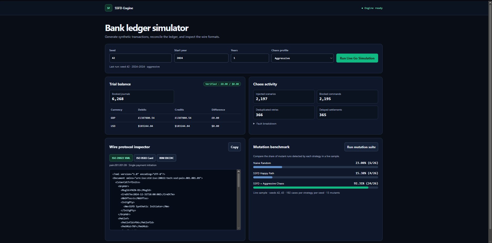
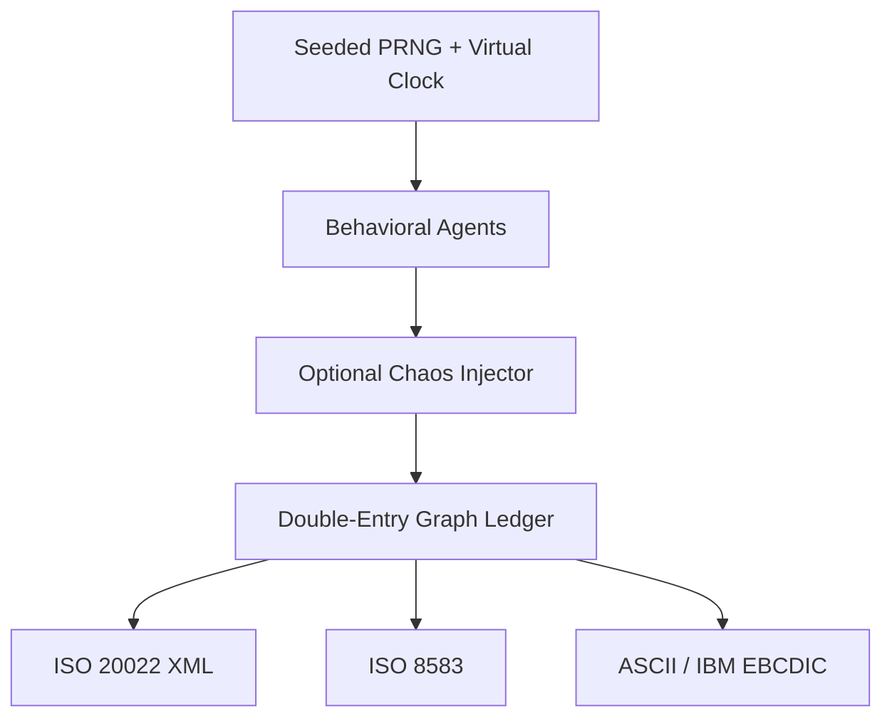

# SSFD-Engine

[](https://github.com/Mohammed-Harunani/ssfd-engine/actions/workflows/ci.yml)


**Deterministic synthetic banking data for ledger reconciliation, migration testing, and defect detection.**

SSFD-Engine generates multi-year account and transaction histories from synthetic inputs. A seed and fixed configuration reproduce the same workload. Each booked journal balances independently by currency, with money represented in integer minor units. The exporter produces modern payment and statement fixtures alongside legacy card messages and mainframe batches.



## Launch the Web UI

```bash
go run ./cmd/ssfd-ui
```

Open [localhost:8080](http://localhost:8080). Run a live simulation to see the GBP
and USD reconciliation, inspect ISO 20022, ISO 8583, and IBM CP037 samples, or
run the two-seed mutation comparison. The console and API are served by one Go
binary with embedded assets.

Use `go run ./cmd/ssfd-ui -addr localhost:8081` if port 8080 is already in use.

## Architecture



- **Model customer activity.** Simulate payroll, rent, loan servicing, merchant purchases, P2P transfers, and GBP/USD payments.
- **Exercise edge cases.** Replay duplicate commands, delayed settlement, DST overlaps, leap-day accrual, overdraft boundaries, partial refunds, and synthetic freeze and release scenarios.
- **Reconcile exported data.** Trace protocol records to canonical postings using the JSON snapshot and checksummed manifest. The ISO 20022 samples include `pain.001.001.09` and `camt.053.001.08`. Both were validated against their official archived XSDs.

## Verified Phase 6 benchmark

The reference run used Go 1.24.13 on Linux amd64 with `GOMAXPROCS=4`. The million-journal workload measured generation and audit. Serializer throughput was measured separately through 100,000 journals.

| Workload | Journals | Postings | Median journals/sec | Trial-balance discrepancy |
| --- | ---: | ---: | ---: | --- |
| One-year behavioral simulation | 1,872 | 3,866 | 54,137 | £0.00 / $0.00 |
| Ten-year behavioral simulation | 18,648 | 38,284 | 53,539 | £0.00 / $0.00 |
| Stress run | 100,000 | 200,000 | 54,736 | £0.00 / $0.00 |
| Million-journal stress run | 1,000,000 | 2,000,000 | **50,057** | **£0.00 / $0.00** |

Both million-journal repetitions produced the same canonical digest. Peak sampled Go heap was 4.64 GiB.

## Mutation experiment

The experiment evaluated 13 isolated defects in a mock banking ledger across 12 matched seeds.

| Test-data strategy | Mutant runs caught | Detection score |
| --- | ---: | ---: |
| Naive random | 37 / 156 | 23.72% |
| SSFD happy path | 24 / 156 | 15.38% |
| SSFD with aggressive chaos | **142 / 156** | **91.03%** |

The strategies used equal case counts. Multi-operation chaos cases exercised more operations, and only the naive strategy caught the domestic currency-mismatch mutant. See [Evaluation Results](EVALUATION_RESULTS.md) for the paired comparisons, raw results, and limitations.

## Quick start

Requires Go 1.22 or later. The Go module uses only the standard library. A C compiler is required for race-enabled tests on Linux.

```bash
# Run the simulator and print the per-currency audit
go run ./cmd/ssfd-demo -seed 42

# Generate the protocol fixtures in a new output directory
go run ./cmd/ssfd-demo -seed 42 -export-dir test-exports

# Run the aggressive simulation
go run ./cmd/ssfd-demo -seed 42 -chaos-profile aggressive

# Run repository checks and reproduce the evaluation
go vet ./...
go test -race -cover ./...
go run ./cmd/ssfd-eval -mode all -format markdown
```

## Project evidence

- [Benchmark and mutation methodology](PHASE_6.md)
- [Measured results and raw evidence](EVALUATION_RESULTS.md)
- [Protocol profiles and COBOL copybook](PHASE_5.md)
- [Generated protocol samples](samples/)
